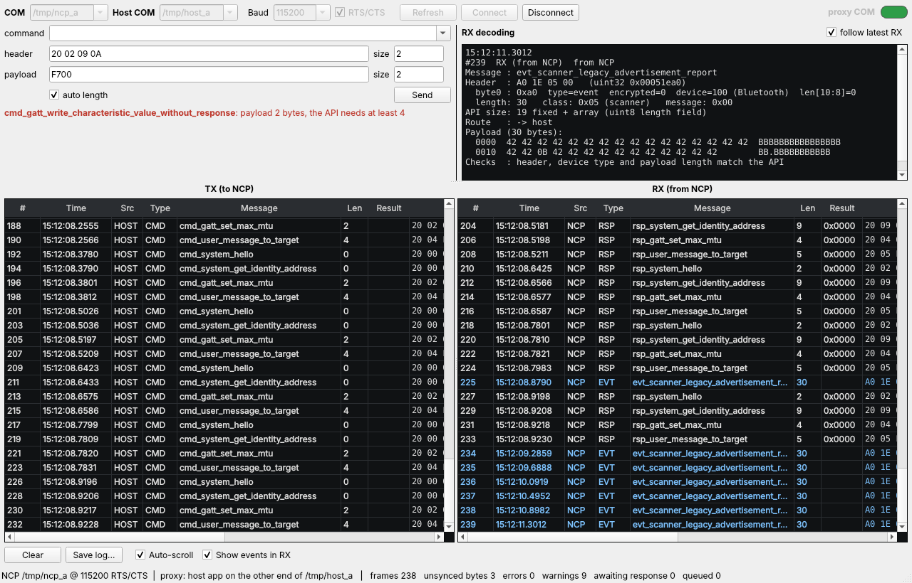

# BGAPI Monitor (bgmon) 1.0

A desktop tool to test & decode BGAPI messages for developers: it shows every byte of BGAPI traffic between a host application (the TMS Configurator) and the Silicon Labs NCP, and lets you send your own commands.

## Download the Windows build

Every push is built by GitHub Actions (`.github/workflows/build-windows.yml`): Qt 6.12 LTS + MinGW 64-bit, tests run, then packaged with `windeployqt`.

1. Open the **Actions** tab, choose the latest green **Build Windows x64** run.
2. Under **Artifacts**, download **bgmon-windows-x64** and unzip it.
3. Run `tests\test_core.exe` and `tests\test_proxy_bglib.exe` (each must end with *passed* / *PASSED*), then `bgmon.exe`.

Pushing a tag such as `v1.0` also attaches the zip to a GitHub Release.

---

A Windows desktop tool (C++ / Qt 6) that shows every byte of BGAPI traffic between a host application (the TMS Configurator) and the Silicon Labs NCP. Each frame is shown in hex and ASCII, decoded by name, and checked against the SDK's own definitions. You can also send your own BGAPI commands to the NCP from the tool.



*Proxy mode: the real Silicon Labs host library (left, HOST) talking to an NCP through the tool, which also slots in its own commands (TOOL) and decodes everything.*

---

## 1. Two ways to use it

| Mode | Wiring | Use it for |
|---|---|---|
| **Direct** (proxy COM off) | `bgmon` ⇄ NCP COM port | Talking to the NCP yourself: send commands, read responses and events |
| **Proxy** (proxy COM on) | TMS Configurator ⇄ virtual COM pair ⇄ `bgmon` ⇄ NCP COM port | Watching the Configurator's real traffic live, and sending your own commands while it runs |

### Proxy setup (one-time): virtual COM pair with com0com

Windows lets only one program open a COM port, so the tool sits in the middle:

1. Install **com0com** (use the *signed* build on Windows 10/11).
2. In an administrator prompt, in the com0com folder, run:
   `setupc install PortName=COM20 PortName=COM21`
   This creates the pair COM20 ⇄ COM21. Any two free numbers will do.
3. In **bgmon**: set COM = the NCP port (for example COM7), switch **proxy COM** on, and set Host COM = **COM20**. Then click **Connect**.
4. Start the **TMS Configurator** and choose **COM21** at its port prompt. Connect bgmon *before* starting the Configurator.

The Configurator needs no change. Its own registry port scan (`serial_transport_scan_ports`) lists COM21 like any other port. bgmon uses the same scan, so the com0com ports appear in its list too.

---

## 2. The window

| Area | What it does |
|---|---|
| **COM / Host COM / Baud / RTS/CTS** | Port settings. The defaults (115200 8N1 with RTS/CTS, DTR on) match `serial_transport.c`. The Host COM field appears only when **proxy COM** is on. |
| **command** | Optional searchable list of all 252 commands. Picking one fills a correct header and a zeroed payload of its API size, which you then edit. |
| **header / size** | 4 header bytes in hex. *size* shows the payload length encoded in the header. |
| **payload / size** | Payload bytes in hex. *size* shows how many bytes you typed. With **auto length** ticked, the header's length field follows the payload. |
| **check line** | A live check before sending: message name, plus whether the header, device type and payload size match the API. A frame that doesn't match asks for confirmation before it is sent. |
| **RX decoding** | Full breakdown of the newest RX frame, or of any row you click: header bits, class, message, API size, result and status name, which command it answers and the round-trip time, a hex+ASCII dump, and every check that failed. |
| **TX / RX** | One row per frame or unsynced run. **TX** holds HOST commands (proxy mode) and TOOL commands; **RX** holds everything from the NCP. Columns: #, time (0.1 ms), source, type, message, length, result, hex, ASCII, and status/route. |
| **Clear / Save log** | Save as `.txt` (readable) or `.csv`. Every record is saved, in sequence order. |
| **Status bar** | Frames, unsynced bytes, errors, warnings, commands awaiting a response, tool commands queued. |

**Colours:** red row = protocol error, amber = warning, blue background = sent by this tool, blue text = event, orange result = non-zero status.

---

## 3. How it avoids false readings

The tool reads both directions of the byte stream itself. It does **not** use the Silicon Labs host library for this, because that library hides exactly the things you need to see.

**Framing.** A frame starts only at a byte whose bits say "Bluetooth, not encrypted" (host→NCP: command only). Its class and message ID must exist in the SDK's API, and its length must be ≤ 256. This is the rule BGLib uses (`sli_wait_for_bgapi_message`), with one difference: rejected bytes are **kept and shown** as `unsynced bytes (n)`, not silently discarded. Every byte received ends up in exactly one row. If a frame stops mid-way (no byte for 200 ms), it is shown as `truncated frame (x of y bytes)`.

**Checks on every frame.** The tables in `src/core/bgapi_tables.c` are generated from your `sl_bt_api.h` / `sli_bt_api.h` / `sl_status.h`. Payload sizes come from `sizeof()` of the SDK's own packed structs, so the compiler decides them, not a hand-made list. For every frame the tool checks:
- the length is exactly the API size, or, for messages ending in an array, exactly the fixed part plus the array's own length field;
- 2-byte responses: recognised as the NCP's generic error response (result only) and shown with the status name;
- device-type bits and the encrypted bit;
- the header length field against the bytes that actually follow (Send panel).

**Command ↔ response matching.** The NCP answers commands strictly in order, so the oldest outstanding command with the same ID is the one being answered. The tool links the two both ways and shows the round-trip time. It also flags:
- *unsolicited response*: no command with this ID is waiting. In proxy mode it also names the host command that BGLib would wrongly pair it with;
- *no response*: a later command was answered first, or none came within 2 s. A late answer within 30 s is still matched and marked *late*.

BGLib itself never makes these checks: it takes the next response it sees as the answer, whatever its ID.

**Proxy rules.** These keep the host app unaffected:
- Host frames are forwarded unchanged and in order.
- A command from the tool is sent only when no command is waiting for a response.
- While a tool command is outstanding, a new host command is held, then sent the moment the tool's response arrives (or after 2 s with no response).
- The tool's responses are **never** forwarded to the host. Everything else from the NCP (responses to the host, events, even unsynced bytes) is forwarded byte for byte.

---

## 4. What was checked

| Test | Result |
|---|---|
| `test_core`: every one of the 587 SDK messages built at its exact API size (751 frames, including array variants) → one clean frame, correct definition, no issues | pass |
| `test_core`: 2,000 streams (40,000 frames) cut into random chunks with noise → 40,000 frames recovered, every byte accounted for; 300 pure-random streams → no crash, every byte accounted for | pass |
| `test_core`: unsynced/resync, truncation timing, generic error response, wrong array length, header/payload mismatch, length > 256, event bit from host, response to an ID outside the table | pass |
| `test_proxy_bglib`: the **real** `sl_bt_ncp_host.c` / `sl_bt_ncp_host_api.c` / `bt_transport_adapter.c` from TMS_Configurator_Host_V4 as the host app, running through the proxy against a simulated NCP that answers each command with result = CRC16 of that command's bytes. 3,000 `sl_bt_*` calls with 300 tool injections (some answered only after the timeout), 6 random seeds | 18,000 calls, **0 wrong results**; the bytes written to the host = NCP output minus tool responses, **byte for byte**; all 1,800 tool commands answered and matched; late answers flagged |
| Same test with a deliberately broken proxy (tool responses leaked to the host) | detected; proves the test can see this failure |
| Direct mode: 400 commands queued at once | sent one at a time, 400/400 matched to the right command |
| End to end on virtual serial ports: real BGLib host app → GUI proxy → simulated NCP, with tool sends during the traffic | 100 host calls OK, 10 tool commands answered, injected junk shown as 3 unsynced bytes |
| Core + tables + both tests compiled for Windows with MinGW-w64 | clean, no warnings |

The Windows build artifact contains both test programs in `tests\` (statically linked, no DLLs). Run them on your PC to confirm the struct sizes and the proxy behaviour on Windows itself (each ends with *passed* / *PASSED*).

**Not yet done:** the GUI has been built and run on Linux (Qt 6.4, offscreen). It has **not** been built or run on Windows, or against the real WSTK, from here. That is the first thing to do on your bench: Direct mode → `system_hello` → `rsp_system_hello` 0x0000, then proxy mode with the Configurator.

---

## 5. Building on Windows

Qt 6 needs MSVC 2019/2022 or MinGW; VS2013 (the Configurator's toolchain) is too old.

**Easiest:** download the CI build (top of this page). To build locally, install Qt 6.12 LTS (the last Qt that supports Windows 10) with the Qt online installer, choosing the *MinGW 64-bit* kit, *Qt Serial Port*, CMake and Ninja.
- Edit the two paths at the top of `build_windows.bat` and run it. It builds, runs the tests, and puts a self-contained `dist\bgmon.exe` together with `windeployqt`.
- Or open `CMakeLists.txt` in Qt Creator and press Build.

Qt 5.15 also works (the CMake file accepts either). Full step-by-step procedure: see the build document.

Command-line options (optional): `--ncp COM7 --host COM20 --baud 115200 --connect --send "20 00 01 00|" --log run.txt`.

---

## 6. Limits worth knowing

- **Timestamps** are when Windows hands the bytes to the program (USB-CDC and driver latency, typically 1–16 ms), not on-wire time. Round-trip times include this.
- **Noise that happens to form a valid header** (Bluetooth device bits, a known class/ID, length ≤ 256) is framed as a message. BGLib does the same. In practice the exact-length check then flags it.
- **Parameter-level decoding** (field names and values) is not included yet. You get the message name, sizes, result/status and the raw bytes. The SDK structs are already linked in, so this can be added later.
- **In proxy mode, events caused by your own commands** (for example `connection_open` → `evt_connection_opened`) also reach the Configurator, which may react to them. Commands that change the radio state should be sent when the Configurator is idle.
- **BGLib drops events** once its 30-entry queue is full, while the host is blocked waiting for a response. The test saw this under load; the monitor still shows every event on the wire. This is relevant for sniffer floods.

---

## 7. What is reused from the Configurator, and what is not

| File | Used for |
|---|---|
| `sl_bgapi.h`, `sl_bt_api.h`, `sli_bt_api.h`, `sl_status.h`, `sl_bt_api_compatibility.h`, `compat.h` (`third_party/silabs`, unchanged) | Source of all IDs, struct sizes and status names (generator + `sizeof`) |
| `serial_transport.c/.h` (`third_party/tms_com`, unchanged) | Windows build only: `serial_transport_scan_ports()` for the port list |
| `sl_bt_ncp_host.c`, `sl_bt_ncp_host_api.c`, `bt_transport_adapter.c/.h` (`tests/silabs_host`, unchanged) | The real host app in the proxy test |

Two pieces were deliberately **not** used inside the tool:
- **`serial_transport.c` for I/O.** It has one static port handle (the proxy needs two) and blocking reads with a 2 s timeout (a GUI must not block).
- **`sl_bt_ncp_host.c` for parsing.** It discards unsynced bytes, drops events when its queue is full, and accepts any response as the answer. A monitor has to show all three.

All reused files are byte-identical to `TMS_Configurator_Host_V4_OOK.zip`.

---

## 8. Layout

```
.github/workflows/build-windows.yml   CI build for Windows x64 (artifact: bgmon-windows-x64)
CMakeLists.txt, build_windows.bat
src/core/   bgapi_core.h/.cpp      parser, checks, session/proxy engine (no Qt)
            bgapi_tables.h/.c      generated from the SDK headers
src/gui/    main.cpp, mainwindow.*, framemodel.*
tools/      gen_bgapi_tables.py    re-run after an SDK update (or -DBGMON_REGEN_TABLES=ON)
tests/      test_core.cpp, test_proxy_bglib.cpp, silabs_host/, e2e/ (pty bench used on Linux)
third_party/silabs, third_party/tms_com   unchanged copies from TMS_Configurator_Host_V4
```

**After an SDK update:** copy the new `sl_bt_api.h`, `sli_bt_api.h` and `sl_status.h` into `third_party/silabs`, then run `python tools/gen_bgapi_tables.py third_party/silabs src/core/bgapi_tables.c` and rebuild.
